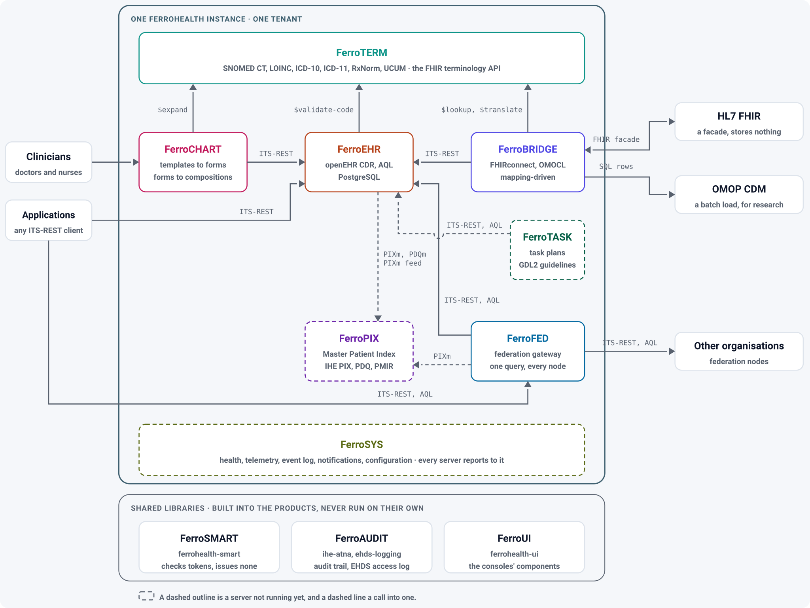

<!-- SPDX-FileCopyrightText: Cadasto B.V. -->
<!-- SPDX-License-Identifier: Apache-2.0 -->
<div align="center">


**A family of health-data servers in Rust, each doing one job and speaking only published standards.**

[Website](https://ferrohealth.eu/) ·
[Family book](https://ferrohealth.eu/docs/) ·
[The products](#the-products) ·
[Licensing](https://ferrohealth.eu/docs/licensing.html)

**Project**<br>
[](https://github.com/FerroHEALTH/FerroHEALTH/actions/workflows/pages.yml)
[](https://ferrohealth.eu/)
[](https://ferrohealth.eu/docs/)
[](LICENSE)
[](TRADEMARKS.md)

**Conformance and compliance**<br>
[](https://ferrohealth.eu/docs/ehds/intended-purpose.html)
[](https://ferrohealth.eu/docs/cra.html)

</div>

## What FerroHEALTH is

Hospitals run many systems that hold parts of the same patient's story:
the record itself, the codes that give it meaning, the patient's identities
across organisations, and the links to research and to other countries.
When one vendor's platform does all of it, changing any part means changing
everything.

FerroHEALTH splits that work into separate servers. Each one does one job,
and each talks to the others only through published standards (openEHR,
HL7 FHIR, IHE), so you can run one alone, combine several, or put another
vendor's product in any place. All of them are written in Rust, released
with signed builds, and made by Cadasto B.V.

This repository holds the family website at <https://ferrohealth.eu/>, the
family book, and the shared brand. It holds no product code.

## The products

| Product | What it does |
|---|---|
| [FerroEHR](https://github.com/FerroHEALTH/FerroEHR) | Stores health records in openEHR, the open standard for structured clinical data ([ferroehr.eu](https://ferroehr.eu/)) |
| [FerroBRIDGE](https://github.com/FerroHEALTH/FerroBRIDGE) | Translates records to HL7 FHIR and to the OMOP research model, and brings HL7 v2 messages in ([ferrobridge.eu](https://ferrobridge.eu/)) |
| [FerroFED](https://github.com/FerroHEALTH/FerroFED) | Connects records across organisations and borders, including the European MyHealth@EU exchange ([ferrofed.eu](https://ferrofed.eu/)) |
| [FerroPIX](https://github.com/FerroHEALTH/FerroPIX) | Matches a patient's identities across organisations, over the IHE patient-index profiles ([ferropix.eu](https://ferropix.eu/)) |
| [FerroTERM](https://github.com/FerroHEALTH/FerroTERM) | Serves the code systems, such as SNOMED CT, LOINC and ICD, over FHIR ([ferroterm.eu](https://ferroterm.eu/)) |

Work every product needs lives in three shared libraries, each a set of Rust
crates compiled into the products and never run on its own:

| Library | What it does |
|---|---|
| [FerroAUTH](https://github.com/FerroHEALTH/FerroAUTH) | Sign-in and access control: SMART and OAuth 2.0 token checks, and the policy decision |
| [FerroAUDIT](https://github.com/FerroHEALTH/FerroAUDIT) | The audit trail: IHE ATNA and BALP, and the EHDS access record |
| [FerroUI](https://github.com/FerroHEALTH/FerroUI) | The components every operator console is built from |



The [family website](https://ferrohealth.eu/) shows the latest release of
each product and library, and the products that are paused or planned.

## The family book

The [family book](https://ferrohealth.eu/docs/) holds what is true for every
product and for Cadasto B.V. as their manufacturer:

- [How the products fit together](https://ferrohealth.eu/docs/architecture.html)
- [The manufacturer](https://ferrohealth.eu/docs/manufacturer.html), the [security policy](https://ferrohealth.eu/docs/security.html) and [post-market support](https://ferrohealth.eu/docs/post-market.html)
- [The Cyber Resilience Act](https://ferrohealth.eu/docs/cra.html) and [the EHDS EHR system](https://ferrohealth.eu/docs/ehds/intended-purpose.html)
- [Licensing and trademarks](https://ferrohealth.eu/docs/licensing.html)

## Quick start

Build the website and the book locally, with the tools
`scripts/site/toolchain.sh` pins:

```bash
scripts/site/assemble.sh _site
python3 -m http.server -d _site 8000
```

Then open <http://localhost:8000/>. [CONTRIBUTING.md](CONTRIBUTING.md) has
the checks, the layout of the repository and how the site is deployed and
kept fresh.

## Learn more

- [Contributing](CONTRIBUTING.md) and the [security policy](SECURITY.md)
- [The brand](assets/brand/README.md) and [the architecture diagram](assets/diagrams/README.md)
- [Trademarks](TRADEMARKS.md)

## Licence

The site, the scripts and the documentation here are [Apache-2.0](LICENSE);
the brand artwork in `assets/brand/` and `assets/diagrams/` is all rights
reserved under [`TRADEMARKS.md`](TRADEMARKS.md). The products and the shared
libraries are under the Business Source License 1.1, with Apache License 2.0
as the Change License, each with the parameters in its own repository's
licence file; the [licensing page](https://ferrohealth.eu/docs/licensing.html)
names every one.

openEHR® is a registered trademark of the openEHR Foundation. HL7® and FHIR®
are registered trademarks of Health Level Seven International. SNOMED CT® is a
registered trademark of SNOMED International. None of these organisations
endorse FerroHEALTH.
